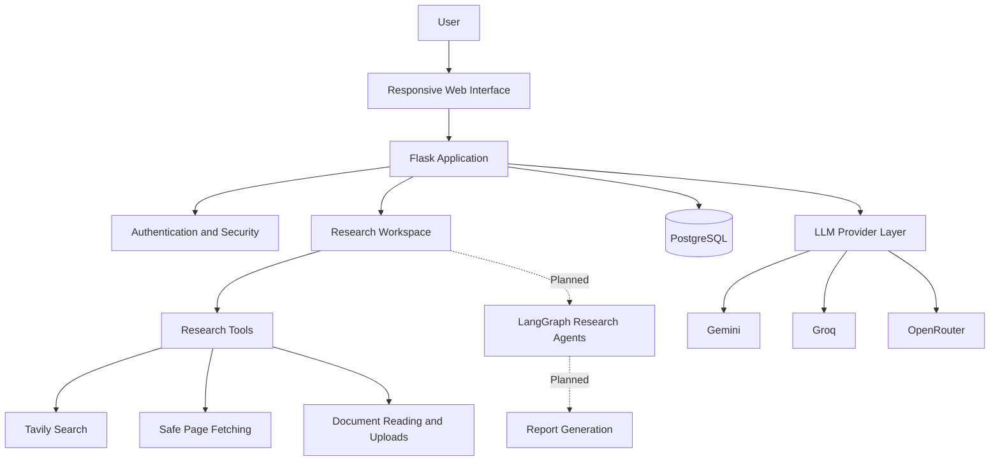

# 🔬 ResearchPilot AI

<p align="center">
  <strong>Your research workflow, engineered for accuracy.</strong>
  <br>
  A multi-agent research and report-generation platform built with Flask, PostgreSQL, and LangGraph.
  <br><br>
  
  
  
  <br>
  
  
  
  
  
</p>

---

## 🧭 Overview

ResearchPilot AI is an AI-powered research platform being developed to help users organize research projects, gather information from online sources, evaluate evidence, and ultimately produce structured, source-backed reports.

The long-term vision is a coordinated research workflow in which specialized AI agents handle different research tasks, share structured findings, and contribute to a final report.

The foundation is already in place: authentication, database-backed research workspaces, research tools, and a resilient LLM provider layer. The multi-agent execution pipeline and report-generation experience are planned for subsequent development phases.

> **⚠️ Development status**
>
> This project is actively under development. Phases 0–5 of 13 are complete. Research agents, background research runs, the report editor, and export functionality have not yet been implemented. The current interface does not represent these features as operational.

## ✨ What ResearchPilot Aims to Deliver

<table>
<tr>
<td width="50%" valign="top">

### 🔎 Intelligent Research

- Web search through Tavily
- Safe web-page fetching
- Document reading and uploads
- Source and evidence management
- Structured research tasks
- Traceable claims and supporting evidence

</td>
<td width="50%" valign="top">

### 🧠 Multi-Agent Intelligence

- Specialized research agents
- LangGraph-based orchestration
- Coordinated research workflows
- Evidence-grounded synthesis
- Quality evaluation
- Structured report generation

*Agent execution and orchestration are planned, not yet implemented.*

</td>
</tr>
<tr>
<td width="50%" valign="top">

### 📝 Report Workspace

- Organized research projects
- Research job and task tracking
- Report revisions
- Report editing
- Multiple export formats
- Persistent research history

*The underlying data model exists; report execution, editing and exports remain planned.*

</td>
<td width="50%" valign="top">

### 🛡️ Secure by Design

- Email verification
- Password reset and change
- CSRF protection
- Rate limiting
- Security headers and CSP
- Ownership checks
- Secret-redacting application logs

</td>
</tr>
</table>

## 📍 Development Roadmap

<details open>
<summary><strong>Completed foundation — Phases 0–5</strong></summary>

| Phase | Area | Status |
|---:|---|:---:|
| 0 | Project foundation and configuration | ✅ Complete |
| 1 | Account system and authentication | ✅ Complete |
| 2 | LLM provider adapters, key rotation and fallback | ✅ Complete |
| 3 | Research and reporting database schema | ✅ Complete |
| 4 | Research tools, source fetching and document uploads | ✅ Complete |
| 5 | Research workspace and project management | ✅ Complete |

</details>

<details>
<summary><strong>Remaining development — Phases 6–12</strong></summary>

The remaining phases are tracked in [`docs/PROGRESS.md`](docs/PROGRESS.md). They cover the functionality needed to turn the existing foundation into a complete research and report platform.

| Area | Status |
|---|---|
| Research agent implementation | ⏳ Not built |
| Background research execution | ⏳ Not built |
| Research progress and task execution | ⏳ Not built |
| Report generation and editing | ⏳ Not built |
| Report export workflows | ⏳ Not built |
| Remaining integration, quality and release work | ⏳ Planned |

The exact phase-to-feature mapping should follow `docs/PROGRESS.md`, which is the authoritative development plan.

</details>

## ✅ What Works Today

The current implementation provides a functional foundation rather than a finished multi-agent research product.

### 🔐 Authentication and account security

- Registration and email verification using SMTP
- Login and logout
- Password reset and password change
- Single-use, expiring email tokens stored as hashes
- Session invalidation after password changes
- CSRF protection and rate limiting
- Content Security Policy and security headers
- Application logs designed to redact secrets

### 🗄️ Database and research workspace

- Flask application factory
- Validated application configuration
- PostgreSQL database models and Alembic migrations
- Research projects and related persistence models
- Project creation with server-side settings validation
- Project listing and search
- Individual project pages
- Project archiving
- Deletion protected by title confirmation
- Dashboard counts derived from database records
- Ownership checks on user-specific resources

The research schema includes projects, jobs, tasks, sources, evidence, claims, reports, revisions, quality evaluations, usage records, and audit events.

**Important:** The database models for research execution and reporting do not mean those workflows are already operational. Research runs cannot yet be started.

### 🔌 LLM provider infrastructure

The provider layer contains adapters for:

- Google Gemini
- Groq
- OpenRouter

It also includes:

- API-key rotation
- Cross-provider fallback
- Bounded retries
- Structured-output validation
- Error handling for provider failures

The provider behavior has been tested against a local fake server. Live integration with the external providers has not yet been fully verified.

See [`docs/API_KEY_ROTATION.md`](docs/API_KEY_ROTATION.md).

### 🌐 Research tools

The implemented research-tool foundation includes:

- Tavily-powered web search integration
- Safe page fetching
- Document reading
- File uploads

These tools provide building blocks for the future agent workflows. Their presence does not imply that an autonomous research pipeline is complete.

### 🎨 User interface and application health

- Responsive interface
- Light and dark themes
- Honest empty states
- Database-backed project counts
- Health endpoint at `/health`

The health endpoint checks application and database availability; it should not be interpreted as a complete verification of every external provider or background service.

## 🏗️ Architecture

ResearchPilot AI is organized around a Flask backend, a relational database, research tooling, and an LLM provider abstraction.



*The dashed components represent planned functionality, not a working end-to-end pipeline.*

### Technology stack

| Technology | Purpose |
|---|---|
| Python | Application and backend logic |
| Flask | Web application and request handling |
| PostgreSQL | Persistent relational data |
| SQLAlchemy | Database models and ORM |
| Alembic / Flask-Migrate | Database migrations |
| LangGraph | Planned multi-agent orchestration |
| Gemini, Groq, OpenRouter | LLM provider integrations |
| Tavily | Web research search |
| Redis | Configured infrastructure dependency, where required |
| HTML, CSS and JavaScript | Responsive web interface |
| Python unittest tooling | Automated tests |

The presence of a technology in the intended stack does not imply that all related workflows are complete.

## 🚀 Quick Start

### Prerequisites

- Python 3.11 or newer
- PostgreSQL
- Git
- SMTP credentials for real email verification and password-reset messages
- Provider API keys for live LLM integration tests

Redis configuration is included in the environment setup. Follow the project's installation guide to determine when the Redis service is required.

### 1. Clone the repository

Replace the placeholder with your repository's actual Git URL.

```bash
git clone <YOUR-REPOSITORY-URL>
cd researchpilot
```

### 2. Create a virtual environment

**Linux / macOS**

```bash
python3 -m venv .venv
source .venv/bin/activate
```

**Windows PowerShell**

```powershell
py -3.11 -m venv .venv
.venv\Scripts\Activate.ps1
```

### 3. Install dependencies

```bash
python -m pip install --upgrade pip
pip install -r requirements-dev.txt
```

### 4. Configure environment variables

Copy the example environment file.

**Linux / macOS**

```bash
cp .env.example .env
```

**Windows PowerShell**

```powershell
Copy-Item .env.example .env
```

Generate a secure application secret:

```bash
python -c "import secrets; print(secrets.token_hex(32))"
```

Set the generated value as `SECRET_KEY` in `.env`. Configure `DATABASE_URL`, the `MAIL_*` variables, and the other settings according to `.env.example` and [`docs/ENVIRONMENT_SETUP.md`](docs/ENVIRONMENT_SETUP.md).

Never commit your real `.env` file, passwords, or API keys to version control.

### 5. Prepare the database

Ensure PostgreSQL is running and the configured database exists. Apply the migrations:

```bash
flask --app app db upgrade
```

### 6. Start the development server

```bash
flask --app app run --debug
```

Use the local address printed by Flask to open the application in your browser.

> **Development only:** The Flask debug server is not intended for public production deployment.

## 🩺 Environment Diagnostics

Use the built-in environment checker to diagnose your local setup.

```bash
# Check configuration, PostgreSQL and Redis
python scripts/check_env.py

# Also attempt live provider-key verification
python scripts/check_env.py --live
```

The live check requires correctly configured provider credentials and network access. Passing a configuration check does not guarantee that all research workflows are functional.

For Windows-specific instructions, PostgreSQL configuration, migrations, and local email testing, read [`docs/INSTALLATION.md`](docs/INSTALLATION.md).

## 🔐 Security Highlights

Security is part of the current foundation, not a replacement for a full production security review.

| Control | Implementation |
|---|---|
| Authentication | Registration, login, logout and account recovery |
| Email tokens | Hashed, single-use and expiring tokens |
| Session management | Session invalidation after password changes |
| CSRF | Request-forgery protection |
| Rate limiting | Limits on protected request flows |
| Browser security | CSP and security headers |
| Logging | Secret-redacting logs |
| Authorization | Ownership checks for user-specific research resources |
| Configuration | Validated environment and application settings |
| Research input handling | Safe-fetching and upload-handling safeguards |

Read [`docs/SECURITY.md`](docs/SECURITY.md) for the project's SSRF, prompt-injection, upload-handling, and uncovered-risk documentation.

AI-generated research can still contain incorrect claims, incomplete evidence, or misleading interpretations. Any future report-generation pipeline should retain source traceability and make verification possible.

## 🧪 Testing

The project currently reports **227 automated tests**, run against PostgreSQL and SQLite.

Run the test suite using the commands and test configuration documented in the repository.

The tests cover the implemented foundation, including authentication, configuration, persistence, provider behavior, research workspace operations, and security-sensitive behavior.

Provider tests currently use a local fake server rather than establishing that all live external services work correctly. Test results also do not imply that unimplemented agent and reporting workflows have been tested end to end.

## 📚 Documentation

<details open>
<summary><strong>Setup and configuration</strong></summary>

- [`docs/INSTALLATION.md`](docs/INSTALLATION.md) — Windows, Linux/macOS setup, running the application, testing and local email.
- [`docs/ENVIRONMENT_SETUP.md`](docs/ENVIRONMENT_SETUP.md) — environment variables and configuration.
- [`docs/DATABASE_SETUP.md`](docs/DATABASE_SETUP.md) — PostgreSQL, migrations and troubleshooting.

</details>

<details>
<summary><strong>Architecture and security</strong></summary>

- [`docs/ARCHITECTURE.md`](docs/ARCHITECTURE.md) — project structure, request flow and design decisions.
- [`docs/SECURITY.md`](docs/SECURITY.md) — SSRF, prompt injection, uploads and known security gaps.
- [`docs/API_KEY_ROTATION.md`](docs/API_KEY_ROTATION.md) — provider key rotation and fallback behavior.
- [`docs/DATABASE_SCHEMA.md`](docs/DATABASE_SCHEMA.md) — research data model and ownership design.

</details>

<details>
<summary><strong>Project progress</strong></summary>

- [`docs/PROGRESS.md`](docs/PROGRESS.md) — phase-by-phase progress, completed functionality and known limitations.

</details>

## ⚠️ Current Limitations

ResearchPilot AI is still in active development.

- Research agents are not yet implemented.
- Background research runs cannot yet be started.
- End-to-end multi-agent orchestration is not yet available.
- The report editor and export workflows are not yet built.
- Live LLM provider integrations have not yet been fully verified.
- A passing health check does not confirm all external services are available.
- The project has not yet established production deployment readiness.

The application should be evaluated according to its implemented features rather than its long-term product vision.

## 🗺️ Future Direction

The remaining development phases are intended to build on the current foundation and move toward:

- Coordinated research-agent workflows
- Background execution and progress tracking
- Source-linked evidence and claim management
- Structured research synthesis
- Report generation and revision history
- Report editing and export formats
- End-to-end workflow tests
- More comprehensive live-provider verification
- Deployment and operational hardening

These are development goals, not claims about the current release.

## 🤝 Contributing

ResearchPilot AI is being developed incrementally, with an emphasis on security, reproducibility, clear architecture, and honest feature status.

For proposed contributions:

1. Review the architecture and current progress documentation.
2. Keep changes focused and compatible with the existing application structure.
3. Add tests for new functionality and regression cases.
4. Update documentation when behavior, configuration, or security assumptions change.
5. Run the relevant automated tests before submitting changes.

## 📄 License

Add or consult the repository's `LICENSE` file for the project's applicable license terms.

---

<p align="center">
  <strong>🔬 ResearchPilot AI</strong>
  <br>
  <em>From research foundations to evidence-driven intelligence.</em>
  <br><br>
  <sub>Built with Python, Flask, PostgreSQL and an evolving multi-agent architecture.</sub>
</p>
