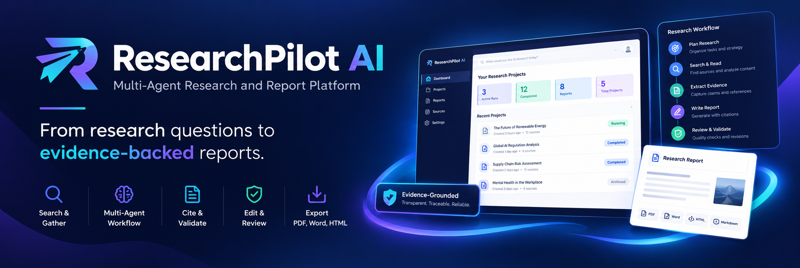
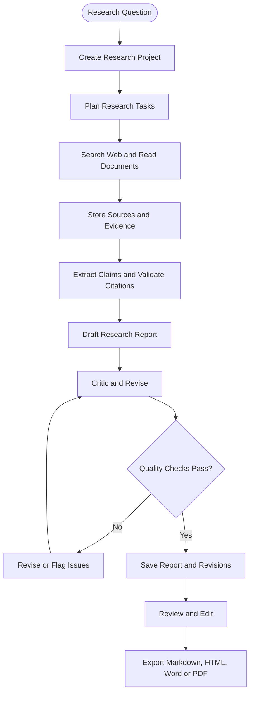
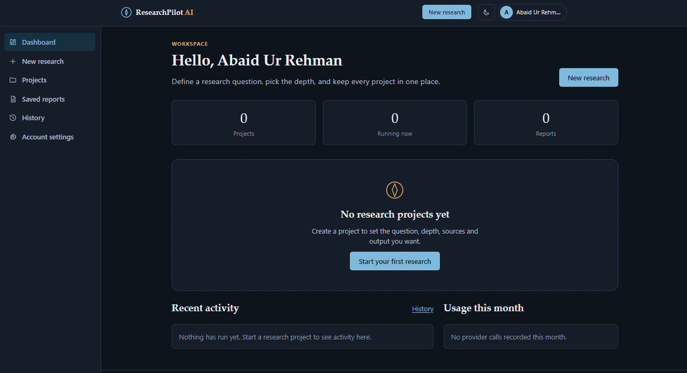
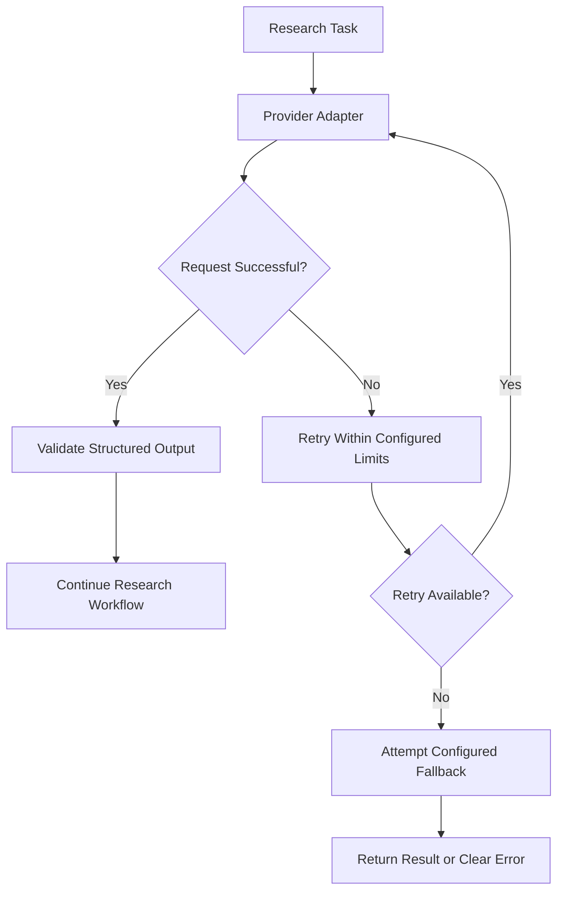

# 🔬 ResearchPilot AI

<p align="center">
  
</p>

<p align="center">
  <strong>From research questions to evidence-backed reports.</strong>
  <br>
  An AI-powered research and report-generation platform built with Flask, PostgreSQL, and LangGraph.
  <br><br>
  
  
  <br>
  
  
  
  
  
</p>

---

## 🧭 Overview

ResearchPilot AI transforms a research question into a structured, source-backed report through a coordinated AI research workflow.

Describe your research objective, optionally upload supporting documents, and let the platform organize the work, search for information, read sources, extract evidence, evaluate claims, and draft a cited report.

The platform supports report editing, revision history, transparent quality checks, and export to Markdown, HTML, Word, and PDF.

**All 13 planned development phases are complete.** However, live integration with the configured LLM and search providers has not yet been verified in the build environment. Feature completion should not be confused with verified production readiness.

> **Important limitations**
>
> - AI-generated reports are research drafts, not guaranteed-correct conclusions. Verify important claims against their cited sources.
> - Research text and uploaded content may be transmitted to the external LLM and search providers configured by the operator.
> - Legal documents are templates containing operator placeholders. They require completion and appropriate legal review before real-world use.
> - Completing the development plan does not establish production readiness or legal compliance.

## ✨ Key Features

<table>
<tr>
<td width="50%" valign="top">

### 🧠 Multi-Agent Research

- LangGraph-based research workflow
- Coordinated research tasks
- Critic-and-revise loop
- Evidence and claim extraction
- Citation validation
- Structured report synthesis

</td>
<td width="50%" valign="top">

### 🌐 Research and Sources

- Tavily web search
- SSRF-safe page fetching
- HTML, PDF, DOCX and TXT reading
- Document uploads
- Untrusted-content handling
- Source explorer and stored excerpts

</td>
</tr>
<tr>
<td width="50%" valign="top">

### 📝 Reports and Exports

- Saved research reports
- Report editor and revisions
- Deterministic quality scoring
- Export-quality gates
- Markdown and HTML export
- Word and PDF export

</td>
<td width="50%" valign="top">

### ⚙️ Background Execution

- Thread, Celery or manual runners
- Live progress reporting
- Run recovery and resume support
- Job and task tracking
- Persistent research history
- Database-backed dashboard

</td>
</tr>
<tr>
<td width="50%" valign="top">

### 🔌 Resilient LLM Infrastructure

- Gemini, Groq and OpenRouter
- API-key rotation
- Cross-provider fallback
- Bounded retries
- Structured-output validation
- Provider error handling

</td>
<td width="50%" valign="top">

### 🛡️ Security and Account Controls

- Registration and email verification
- Password reset and preferences
- CSRF protection and rate limiting
- Strict Content Security Policy
- Hardened security headers
- Secret-redacting logs
- Account-data export and scheduled deletion

</td>
</tr>
</table>

## 🔄 How It Works



*Conceptual workflow overview. Actual execution behavior, retry limits, stopping conditions and validation rules are defined in the implementation and project documentation.*

### The research pipeline

1. **Define the objective.** Create a project with the research question and applicable settings.
2. **Plan the work.** Organize the research into tasks.
3. **Gather information.** Search the web and process uploaded documents.
4. **Capture evidence.** Store source material, excerpts, claims and supporting references.
5. **Draft and review.** Generate a report and apply the configured critic-and-revise workflow.
6. **Validate quality.** Run deterministic checks and citation validation.
7. **Refine the report.** Review content, edit sections and track revisions.
8. **Export the result.** Produce Markdown, HTML, Word or PDF output.

## 🖥️ Product Preview

<p align="center">
  
</p>

## 🏗️ Technology Stack

| Technology | Role |
|---|---|
| Python | Application and research logic |
| Flask | Web application and API endpoints |
| PostgreSQL | Persistent application and research data |
| SQLAlchemy | Database models and ORM |
| Alembic / Flask-Migrate | Database schema migrations |
| LangGraph | Multi-agent workflow orchestration |
| Gemini | LLM provider integration |
| Groq | LLM provider integration |
| OpenRouter | LLM provider integration |
| Tavily | Web search integration |
| Redis | Configured infrastructure for supported background workflows |
| Celery | Optional background job execution |
| HTML, CSS and JavaScript | Web interface |
| `unittest` and project test tooling | Automated verification |

The exact optional dependencies and supported runtime modes are defined by the repository's configuration and installation documentation.

## 🚀 Quick Start

### Prerequisites

- Python 3.11 or newer, subject to the repository's supported-version configuration
- PostgreSQL
- Git
- SMTP credentials for real email verification and account-recovery emails
- API keys for the LLM and search providers you intend to use
- Redis when required by the selected background-job configuration

### 1. Clone the repository

Replace the placeholder with your actual repository URL.

```bash
git clone <YOUR-REPOSITORY-URL>
cd ResearchPilot-ai
```

### 2. Create a virtual environment

**Linux / macOS**

```bash
python3 -m venv .venv
source .venv/bin/activate
```

**Windows PowerShell**

```powershell
py -3.11 -m venv .venv
.venv\Scripts\Activate.ps1
```

### 3. Install dependencies

```bash
python -m pip install --upgrade pip
pip install -r requirements-dev.txt
```

### 4. Configure environment variables

Copy the example environment file.

**Linux / macOS**

```bash
cp .env.example .env
```

**Windows PowerShell**

```powershell
Copy-Item .env.example .env
```

Generate a secure application secret:

```bash
python -c "import secrets; print(secrets.token_hex(32))"
```

Place the generated value in `SECRET_KEY` inside `.env`.

Configure the database connection, SMTP settings, provider credentials, and other required values using:

- [`docs/ENVIRONMENT_SETUP.md`](docs/ENVIRONMENT_SETUP.md)
- [`docs/DATABASE_SETUP.md`](docs/DATABASE_SETUP.md)
- [`.env.example`](.env.example)

Never commit real credentials, passwords, or API keys.

### 5. Apply database migrations

Ensure PostgreSQL is running and the configured database exists.

```bash
flask --app app db upgrade
```

### 6. Start the development server

```bash
flask --app app run --debug
```

Open the local URL printed in the terminal.

> The Flask debug server is for local development. Follow [`docs/DEPLOYMENT.md`](docs/DEPLOYMENT.md) for deployment configuration and operational requirements.

## 🩺 Environment Diagnostics

Check your local configuration and infrastructure:

```bash
# Check configuration, PostgreSQL and Redis
python scripts/check_env.py

# Also attempt live provider-key verification
python scripts/check_env.py --live
```

The live check requires network access and valid provider credentials. A successful environment check does not guarantee that every external provider, background runner, or end-to-end workflow is functioning correctly.

For Windows-specific instructions, PostgreSQL configuration, and local email testing, see [`docs/INSTALLATION.md`](docs/INSTALLATION.md).

## 📊 Quality, Evidence and Citations

ResearchPilot AI is designed to make research output more inspectable than an unstructured AI response.

### Evidence traceability

The research data model supports persistent records for:

- Sources and source excerpts
- Extracted claims
- Evidence associated with claims
- Research jobs and tasks
- Reports and revisions
- Quality evaluations
- Usage records and audit events

### Quality checks

The platform includes deterministic quality scoring, citation validation, and export gates.

These mechanisms can help identify missing citations or other predefined quality problems. They cannot guarantee that a source is authoritative, that a cited passage fully supports a claim, or that an AI-generated conclusion is factually correct.

**Always verify consequential claims against the original sources.**

See [`docs/QUALITY_AND_EXPORTS.md`](docs/QUALITY_AND_EXPORTS.md) and [`docs/AGENT_WORKFLOW.md`](docs/AGENT_WORKFLOW.md).

## 🔌 LLM Provider Reliability

The provider layer supports Gemini, Groq and OpenRouter, with key rotation, fallback, bounded retries, and structured-output validation.

The intended reliability flow is:



The diagram illustrates the general design. Actual provider ordering, retry behavior, key rotation, and fallback rules are governed by the implementation and configuration.

**Live-provider verification remains outstanding.** A functioning adapter or a successful fake-server test is not equivalent to a verified live integration.

Read [`docs/API_KEY_ROTATION.md`](docs/API_KEY_ROTATION.md).

## 🛡️ Security and Privacy

ResearchPilot AI includes security controls for accounts, requests, external content, and application operations.

| Area | Controls |
|---|---|
| Authentication | Registration, verification, login and account recovery |
| Request protection | CSRF protection and rate limiting |
| Browser security | Strict CSP and hardened security headers |
| Credential handling | Secret-redacting logs |
| External URLs | SSRF-safe fetching controls |
| Document processing | File handling and untrusted-content safeguards |
| Research authorization | Ownership checks on user-specific resources |
| Account lifecycle | Preferences, data export and scheduled deletion |
| Legal information | Public `/legal` pages generated from `docs/legal/` |

### Important privacy disclosure

Research text, prompts, source excerpts, and uploaded content may be sent to the external LLM and search providers configured for the application.

Before using real or sensitive research material:

- Review the privacy policy and relevant provider data-handling terms.
- Understand which data each configured service receives.
- Avoid submitting secrets or confidential documents unless the relevant handling arrangements are appropriate.
- Complete the legal-document templates and obtain suitable legal review.
- Test account export, deletion, retention, and recovery behavior in the intended deployment configuration.

The presence of security controls does not imply that the system is invulnerable or legally compliant.

See [`docs/SECURITY.md`](docs/SECURITY.md) and [`docs/legal/AI_USAGE_AND_LIMITATIONS.md`](docs/legal/AI_USAGE_AND_LIMITATIONS.md).

## 🧪 Testing and Verification

The project includes automated tests against PostgreSQL and SQLite. Consult [`docs/TESTING.md`](docs/TESTING.md) for the supported test commands, database setup, coverage, and test scope.

Run the environment checker before testing:

```bash
python scripts/check_env.py
```

Then follow the test instructions in the repository.

### What still needs verification?

Although all 13 development phases are complete, the final verification documentation identifies important boundaries:

- Live LLM provider behavior has not been verified in the build environment.
- Live search-provider behavior has not been verified in the build environment.
- Production deployment still requires environment-specific validation.
- Legal templates require operator completion and legal review.
- End-to-end behavior must be validated with the actual provider credentials, infrastructure, and intended runtime configuration.

See [`docs/FINAL_VERIFICATION.md`](docs/FINAL_VERIFICATION.md) for the authoritative verification record.

## 📚 Documentation

<details open>
<summary><strong>Setup and infrastructure</strong></summary>

- [`docs/INSTALLATION.md`](docs/INSTALLATION.md) — Windows and Linux/macOS installation, startup and testing.
- [`docs/ENVIRONMENT_SETUP.md`](docs/ENVIRONMENT_SETUP.md) — environment variables and configuration.
- [`docs/DATABASE_SETUP.md`](docs/DATABASE_SETUP.md) — PostgreSQL, migrations and troubleshooting.
- [`docs/DATABASE_SCHEMA.md`](docs/DATABASE_SCHEMA.md) — research and account data models.

</details>

<details>
<summary><strong>Architecture and AI workflows</strong></summary>

- [`docs/ARCHITECTURE.md`](docs/ARCHITECTURE.md) — structure, request flow and design decisions.
- [`docs/AGENT_WORKFLOW.md`](docs/AGENT_WORKFLOW.md) — coordinated research workflow.
- [`docs/AGENTS.md`](docs/AGENTS.md) — agent responsibilities.
- [`docs/BACKGROUND_JOBS.md`](docs/BACKGROUND_JOBS.md) — runners, Celery, progress reporting and recovery.
- [`docs/API_KEY_ROTATION.md`](docs/API_KEY_ROTATION.md) — provider keys, rotation and fallback.
- [`docs/API_DOCUMENTATION.md`](docs/API_DOCUMENTATION.md) — routes, limits and CLI.

</details>

<details>
<summary><strong>Reports, quality and account data</strong></summary>

- [`docs/EDITOR.md`](docs/EDITOR.md) — report editor and revisions.
- [`docs/QUALITY_AND_EXPORTS.md`](docs/QUALITY_AND_EXPORTS.md) — quality checks, citation validation and exports.
- [`docs/ACCOUNT_DATA.md`](docs/ACCOUNT_DATA.md) — account data operations.

</details>

<details>
<summary><strong>Security, testing and operations</strong></summary>

- [`docs/SECURITY.md`](docs/SECURITY.md) — security controls, threat model and incident response.
- [`docs/TESTING.md`](docs/TESTING.md) — automated testing and verification.
- [`docs/CONTRIBUTING.md`](docs/CONTRIBUTING.md) — contribution guidelines.
- [`docs/DEPLOYMENT.md`](docs/DEPLOYMENT.md) — deployment guidance.
- [`docs/BACKUP_AND_RESTORE.md`](docs/BACKUP_AND_RESTORE.md) — backup and recovery.
- [`docs/TROUBLESHOOTING.md`](docs/TROUBLESHOOTING.md) — common issues and diagnostic steps.

</details>

<details>
<summary><strong>Legal documents and project history</strong></summary>

- [`docs/legal/README.md`](docs/legal/README.md) — legal-document templates and guidance.
- [`docs/legal/AI_USAGE_AND_LIMITATIONS.md`](docs/legal/AI_USAGE_AND_LIMITATIONS.md) — AI limitations and responsible use.
- [`docs/FINAL_VERIFICATION.md`](docs/FINAL_VERIFICATION.md) — acceptance checks and remaining verification.
- [`docs/CHANGELOG.md`](docs/CHANGELOG.md) — project history.
- [`docs/ROADMAP.md`](docs/ROADMAP.md) — future direction.
- [`docs/PROGRESS.md`](docs/PROGRESS.md) — development progress.

</details>

## 🚧 Operational Readiness

The application is feature-complete against its stated specification, but several steps remain before it should be treated as ready for real-world use.

- Verify live LLM and search integrations.
- Validate all background-run modes in the target environment.
- Test migrations, backups, restoration and account lifecycle operations.
- Review security configuration and production deployment settings.
- Complete legal templates and obtain appropriate legal review.
- Test end-to-end research and export workflows with representative documents and questions.

Feature completion is an important milestone; operational readiness must be demonstrated separately.

## 🗺️ Future Direction

With the 13-phase implementation complete, future work can focus on validation, operational hardening, and improvements driven by actual research use.

Potential extensions include:

- Broader live-provider integration testing
- Additional research quality benchmarks
- Stronger source relevance and evidence evaluation
- Improved progress monitoring and failure diagnostics
- Larger-scale background-job testing
- More comprehensive privacy and retention verification
- User feedback-driven improvements to research and report editing

These are potential future improvements rather than claims about current functionality.

## 🤝 Contributing

Contributions are welcome, especially those that improve research reliability, evidence traceability, security, usability, testing, and documentation.

1. Read [`docs/CONTRIBUTING.md`](docs/CONTRIBUTING.md).
2. Review the architecture and relevant workflow documentation.
3. Create a focused branch for your change.
4. Add or update tests.
5. Update documentation for changed behavior or configuration.
6. Run the relevant test suite before submitting a pull request.

Do not include API keys, private documents, production credentials, or sensitive research content in issues, test fixtures, or commits.

## 📄 License

Consult the repository's `LICENSE` file for the applicable software license.

The legal pages under `docs/legal/` are separate templates and are not a substitute for legal advice or a completed legal review.

---

<p align="center">
  <strong>🔬 ResearchPilot AI</strong>
  <br>
  <em>Research systematically. Trace the evidence. Review every conclusion.</em>
  <br><br>
  <a href="docs/INSTALLATION.md">Get Started</a> ·
  <a href="docs/ARCHITECTURE.md">Architecture</a> ·
  <a href="docs/AGENT_WORKFLOW.md">Agent Workflow</a> ·
  <a href="docs/FINAL_VERIFICATION.md">Verification</a>
</p>
