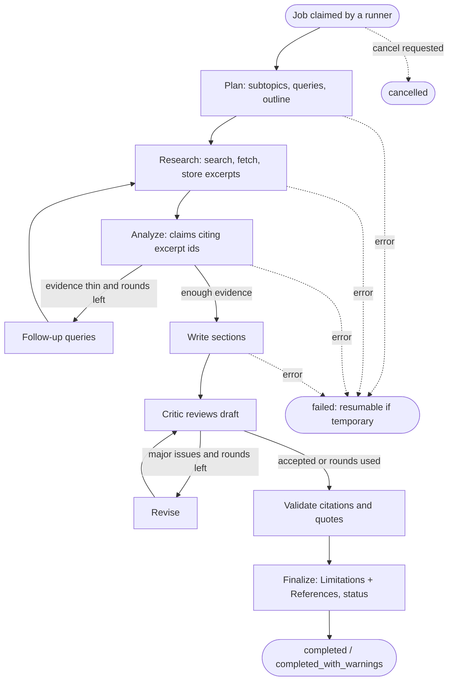
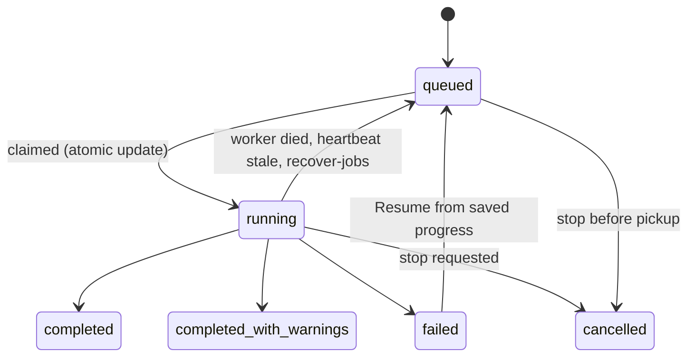

# Agent workflow

How one research run moves from a question to a cited report. The agents themselves are described in
[AGENTS.md](AGENTS.md); background execution in [BACKGROUND_JOBS.md](BACKGROUND_JOBS.md). Code:
`agents/graph.py` (the LangGraph graph), `agents/runner.py` (runs one job to its end).

## The graph

## Run states

Only one active run per project is allowed (a partial unique index in the database). A user can have at
most `MAX_ACTIVE_JOBS_PER_USER` runs in progress.

## What is saved, so resuming is cheap
After each stage the job stores a `checkpoint` and appends events. Tasks, sources, excerpts, claims
and drafted sections are database rows, so a resumed run skips searches already done and sections
already written.

## How the output is made trustworthy (and where it is not)
1. Models receive text and return JSON checked against a schema. They have no tools.
2. Claims must cite excerpt ids that were provided; unknown ids are dropped.
3. The writer may only cite sources it was given; other markers are removed.
4. The validator checks citations and quotations in code, then asks a model whether each (claim,
   excerpt) pair is direct, partial or unrelated.
5. *Limitations* and *References* come from database facts.
6. Quality scoring and the `export_ready` gates run afterwards ([QUALITY_AND_EXPORTS.md](QUALITY_AND_EXPORTS.md)).

These steps reduce unsupported statements; they do not prove the report is correct. Web pages and
uploads are untrusted data ([SECURITY.md](SECURITY.md)).

## Budgets and stopping
Per-run limits come from the project settings (maximum sources, revision rounds, search rounds) and
`AGENT_MAX_LLM_CALLS` and the provider settings in [ENVIRONMENT_SETUP.md](ENVIRONMENT_SETUP.md). When a budget or provider is
exhausted the run fails with a stated reason; if the reason is temporary the run can be resumed.

## Running a job by hand
`flask --app app run-research <project id>` runs the workflow in the foreground (useful with
`JOB_RUNNER=manual`). `flask --app app show-report <job id>` prints the Markdown report.
