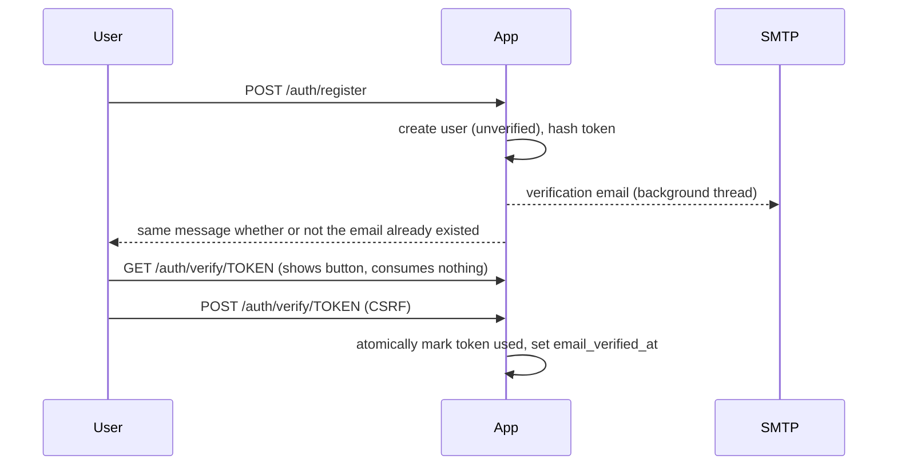
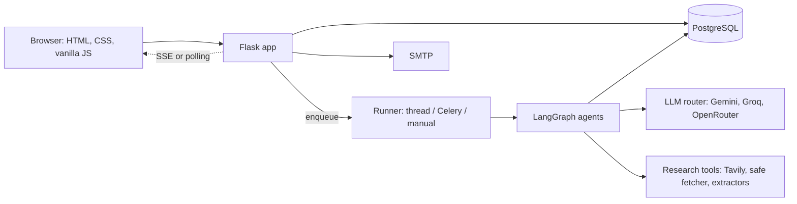

# Architecture

## Layout

```
app.py            create_app(): config, validation, extensions, blueprints, errors, headers
config.py         environment-driven config classes + validate_config()
extensions.py     db, migrate, login_manager, csrf, limiter (naming convention for Alembic)
core/             logging redaction, security headers, error handlers, SMTP mailer, health, URL helper
auth/             models, forms, services (business logic), tokens, routes, decorators
jobs/             Background runners (thread/Celery), claiming, heartbeat, recovery
agents/           Planner, researcher, analyst, writer, critic, validator and the LangGraph workflow
research_tools/    Tavily search, safe fetching (SSRF guard), HTML/PDF/DOCX/TXT extraction, untrusted-content helpers, scoring
providers/        LLM layer: adapters (gemini, groq, openrouter), router, key_manager, models, structured
research/         projects, jobs, tasks, sources, claims: models, settings schema, services, ownership loaders
reports/          report models, editing (optimistic locking, revisions), quality scoring, exports, source explorer routes
dashboard/        landing + dashboard (verified users only)
settings/         profile, password, preferences, report defaults, data export, account deletion (+ CLI)
legal/            public /legal pages rendering docs/legal/*.md
templates/ static/ tests/ migrations/ scripts/ docs/
```

Routes stay thin; business rules live in `auth/services.py` so they are testable without HTTP.

## Account flows



## Security decisions

- **No account enumeration.** Registration and "forgot password" respond identically for known
  and unknown addresses; unknown-user login burns equal hashing time; email is sent in a
  background thread so response time does not leak existence.
- **Tokens.** 256-bit random, only the SHA-256 digest is stored, single-use via an atomic
  `UPDATE ... WHERE used_at IS NULL`, newer tokens supersede older ones, per-account cooldown.
- **Emailed links use `APP_BASE_URL`, never the `Host` header**, preventing password-reset
  poisoning (covered by a test that fails if the fix is removed).
- **Link scanners.** Email links open a confirmation page; the token is consumed only on POST.
- **Sessions.** HttpOnly, SameSite=Lax, Secure in production, cleared on login and logout,
  invalidated everywhere on password change via `auth_version`.
- **CSRF** on every state-changing request. Logout is POST-only.
- **CSP** is `default-src 'self'` with no inline scripts or styles, enforced by a test that
  scans every page. Security headers set on all responses; HTML responses are `no-store`.
- **Open redirects** blocked: `next` must be a same-site relative path.
- **Rate limits** on register, login, reset, resend and password change (per IP). In-memory
  storage is per process; production requires Redis.
- **Logs** pass through a redaction filter (provider key formats, bearer tokens, token URLs,
  connection-string passwords, and the exact values of configured secrets).

## System overview



Request path: routes (thin) -> services (rules) -> models. Long work never runs in a request: a run is
a database row claimed by a runner, which writes progress events the browser reads over Server-Sent
Events (with a polling fallback). See `BACKGROUND_JOBS.md`, `AGENT_WORKFLOW.md`, `EDITOR.md`,
`QUALITY_AND_EXPORTS.md`, `ACCOUNT_DATA.md`, and `docs/legal/` for the policies.

## LLM provider layer (Phase 3)

Application code calls `get_router().generate(LLMRequest(...))` and never talks to a provider
directly. Adapters translate one request into one provider's HTTP API and classify every
failure into an `ErrorKind`; the router decides what to do about each kind (rotate key, retry,
fall back, or give up) and the key manager remembers which keys are cooling down. Structured
output is always validated locally with Pydantic, whatever the provider enforces natively.
Full behaviour: `docs/API_KEY_ROTATION.md`.
