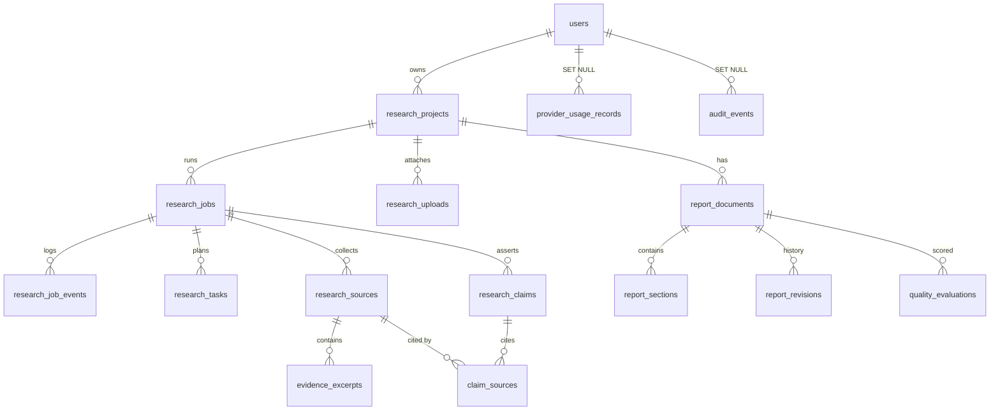

# Database schema

PostgreSQL is the target; tests also run on SQLite. Migrations: `migrations/versions/`
(in order: `60f85f1c5d8b` users and tokens, `5cc0c97d977e` research, reports, quality, usage, audit,
`a7f7526be75d` uploads, `4177381e95ce` job heartbeat, `a24955c09a06` user preferences and deletion request).
Models: `auth/models.py`, `research/models.py`, `reports/models.py`, `providers/usage.py`,
`core/audit.py`. Vocabularies (statuses, categories) live in `research/constants.py` and are
enforced by CHECK constraints, not only by application code.

## Ownership

`research_projects.user_id` is the only ownership column; everything else reaches its owner
through `project -> user`. Routes must load rows with `research/access.py` (`owned_project`,
`owned_job`, `owned_source`, ...), which join to the project and return **404 for both missing
and foreign rows**, so IDs cannot be probed. URLs use random 32-character `public_id`s (projects,
jobs, reports) instead of sequential numbers. `tests/test_models.py` checks every loader against a
second user, by public and by internal ID.

## Tables

| Table | Purpose | Notable constraints |
|---|---|---|
| `users`, `auth_tokens` | Accounts (email, password hash, display name, verification, `auth_version`, `theme_preference`, `notify_on_finish`, `default_settings`, `deletion_requested_at`), one-time email tokens (only a hash is stored) | unique email; see DATABASE_SETUP.md |
| `research_projects` | The request: title, topic, objectives, `depth`, validated `settings` (JSON) | `depth` vocabulary; non-blank title; index `(user_id, created_at)` |
| `research_uploads` | Text extracted from a user's PDF/DOCX/TXT (original file is never stored): filename (display only), kind, size, sha256, page count, text, warnings | unique `(project_id, sha256)`; cascades with the project |
| `research_jobs` (has `heartbeat_at`: refreshed while a worker runs it) | One workflow run: status, stage, agent, rounds, `config_snapshot`, `checkpoint`, cancel flag, `awaiting_decision` + `unresolved_issues`, error info, `event_seq` | status vocabulary (queued ... cancelled); **partial unique index: one active job per project**; rounds >= 0 |
| `research_job_events` | Append-only progress log for live progress and reconnect (`seq` per job) | unique `(job_id, seq)`; level vocabulary |
| `research_tasks` | Questions, subtopics, searches, specialist tasks; parallel group, queries used, status | kind/status/agent vocabularies |
| `research_sources` | Collected sources: URL, canonical URL, `url_hash` (dedupe), domain, title, published/retrieved dates, category, `fetch_status`, `link_status`, `metadata_status`, scores, warnings | unique `(job_id, url_hash)`; needs a URL or an upload name; scores in 0..1 |
| `evidence_excerpts` | Passages from sources, `is_verbatim`, locator | unique `(source_id, content_hash)`; non-empty text |
| `research_claims` | Claims with type (fact/estimate/opinion/inference), support status, analyst confidence | vocabularies; confidence 0..1 |
| `claim_sources` | Claim to source relation (supports/contradicts/context) and `support_level` | unique `(claim_id, source_id, relation)`; **composite foreign keys force the claim and the source to belong to the same job** |
| `report_documents` | The report: title, status, language, `version` (optimistic lock), `current_revision_no`, `export_ready` | one report per job |
| `report_sections` | Sections/subsections (Markdown with `[@S<id>]` citation markers) | unique `(report_id, key)`; level 1-4 |
| `report_revisions` | Edit history: section or whole-document snapshots; `proposed`/`applied`/`discarded` | unique `(report_id, revision_no)`; section revisions keep `section_key` |
| `quality_evaluations` | One row per dimension per run, deterministic and LLM kept separate, with `method` and `details` | unique `(report_id, run_id, evaluator, dimension)`; score 0..100 only when `status='scored'` |
| `provider_usage_records` | Per LLM call: provider, model, key label, outcome, latency, token counts, user, job | no prompts, responses or keys |
| `audit_events` | Account and project actions: type, actor, target, redacted details | sensitive detail names rejected |

Two deliberate design points:

* **Link availability is not verification.** `research_sources.link_status` records whether a
  URL answered; whether a passage actually supports a claim is judged per claim in
  `claim_sources.support_level` (`unreviewed` until checked).
* **Citations point at rows.** Report text uses `[@S12]` (source id 12). The validator can check
  every marker against `research_sources`; free-form URLs inside report text are not citations.

## Deletion rules

| When this is deleted | Effect |
|---|---|
| A user | Their projects and everything below them are deleted (cascade): jobs, events, tasks, sources, excerpts, claims, claim links, reports, sections, revisions, evaluations |
| | `provider_usage_records.user_id` and `audit_events.actor_user_id` become NULL: counts and the fact that an event happened remain, the link to the person does not |
| A project | Jobs and everything below, and its reports, are deleted |
| A job (purge) | Its events, tasks, sources, claims are deleted; the report is kept (`job_id` NULL); usage rows keep their totals |
| A source | Its excerpts and claim links are deleted; the claim stays (and will show as unsupported) |
| A report section | Its revisions stay (`section_id` NULL, `section_key` kept) so history is not lost |

This describes the database. Backups, log files and exports made earlier are outside these
rules; `docs/legal/DATA_RETENTION_POLICY.md` and `ACCOUNT_DATA.md` say so.
Whether keeping anonymised usage and audit rows is acceptable depends on the operator's
jurisdiction and needs legal review.

## Atomicity

* `create_job` relies on the partial unique index, so two simultaneous "start" requests cannot
  both create an active job (tested on PostgreSQL with concurrent threads).
* `append_event` takes the next sequence number with one atomic `UPDATE ... RETURNING`.
* `request_cancel` only touches jobs that are still active; a job that finishes at the same
  moment is not overwritten.
* Audit events are added to the caller's transaction and committed or rolled back with the action.
* Provider usage rows are written on their own connection, so a request that later rolls back
  still keeps the record of the API call it spent.

## Not stored
Original uploaded files (only extracted text), prompts and model responses in usage records, passwords
(only a hash), API keys, and generated export files. The data export is built in memory on request.
