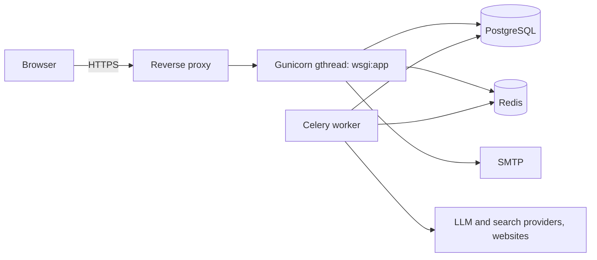

# Deployment

A single-server deployment: reverse proxy (HTTPS) -> Gunicorn -> Flask, PostgreSQL, Redis, and a
Celery worker. The repository contains no Dockerfile or hosting-specific configuration; adapt the
steps to your platform. Replace every value in angle brackets.



## 1. Prepare
* Python 3.11+, PostgreSQL 14+, Redis, a Linux host (Gunicorn does not run on native Windows).
* Create a virtualenv and `pip install -r requirements.txt` (the production set; no dev tools).
* Create the database and a dedicated database user ([DATABASE_SETUP.md](DATABASE_SETUP.md)).
* Create an environment file readable only by the service user (`chmod 600`). Never commit it.
  Variables are listed in [ENVIRONMENT_SETUP.md](ENVIRONMENT_SETUP.md).

## 2. Required production settings
The application refuses to start in production without a correct configuration:

```
FLASK_ENV=production
SECRET_KEY=<64 hex characters from secrets.token_hex(32)>
DATABASE_URL=postgresql+psycopg://<user>:<password>@<host>/<db>
APP_BASE_URL=https://<your domain>          # used in emailed links
TRUSTED_PROXY_COUNT=1                       # number of proxies in front of Gunicorn
RATELIMIT_STORAGE_URI=redis://<host>:6379/1
JOB_RUNNER=celery
REDIS_URL=redis://<host>:6379/0
MAIL_SERVER=... MAIL_PORT=587 MAIL_USE_TLS=true MAIL_USERNAME=... MAIL_PASSWORD=... MAIL_DEFAULT_SENDER=...
GEMINI_API_KEY_1=...   TAVILY_API_KEY=...   # at least one LLM key and the search key
```
Run `python scripts/check_env.py` (add `--live` to verify keys with the providers).

## 3. Migrate and start
```bash
flask --app app db upgrade
gunicorn wsgi:app --bind 127.0.0.1:8000 --worker-class gthread --workers 2 --threads 8 --timeout 120
celery -A jobs.worker.celery_app worker --loglevel=info --concurrency=2
```
Use threaded workers: live progress is a long-lived Server-Sent Events response and plain sync workers
would be tied up by it. Run both commands under a process supervisor (systemd or similar) so they
restart.

## 4. Reverse proxy and HTTPS
Terminate TLS at the proxy, redirect HTTP to HTTPS, and forward `X-Forwarded-For`, `X-Forwarded-Proto`
and `Host`. For the stream route disable response buffering and allow long reads (nginx:
`proxy_buffering off; proxy_read_timeout 120s;` for `/research/` paths). Set `TRUSTED_PROXY_COUNT` to the
exact number of proxies; a wrong value lets clients spoof their IP for rate limiting. The application
already sends HSTS, CSP and other headers in production, so do not duplicate or weaken them.

## 5. Scheduled commands
| Command | Why | Suggested schedule |
|---|---|---|
| `flask --app app purge-accounts` | Deletes accounts whose grace period passed. **Nothing else does** | daily |
| `flask --app app recover-jobs` | Re-queues runs whose worker died | at startup and every few minutes |
| database backup | see [BACKUP_AND_RESTORE.md](BACKUP_AND_RESTORE.md) | daily |

## 6. Before you open it to others
* Fill in and have reviewed the documents in `docs/legal/` (all `[OPERATOR: ...]` placeholders);
  they are served at `/legal`.
* Confirm the providers you enabled and read their data terms.
* Check `/health` from your monitoring and `/health/providers` while signed in.
* Rotate keys with [API_KEY_ROTATION.md](API_KEY_ROTATION.md); never put keys in source, templates or logs.

## 7. Upgrading
Back up, pull the new code, `pip install -r requirements.txt`, `flask --app app db upgrade`, restart
Gunicorn and the worker. Read [CHANGELOG.md](CHANGELOG.md) first. If a migration fails, restore from the
backup rather than editing the database by hand.
